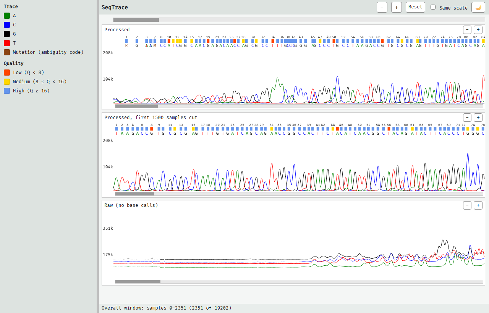

# SeqTrace — Linked DNA Trace Viewer

Example of using three canvas libraries together to show several processed
DNA sequencing traces from a Sanger-style instrument, zoomed and scrolled
together or one at a time:

- **SeqTrace** (`lib/seqtrace.js`) draws one trace: the A/C/G/T lines, base
  numbers, per-base quality bars, called bases and Y labels. Any number of
  instances share a page; the caller sets the view window.
- **SeqScrollBar** (`lib/seqscrollbar.js`) is a horizontal scroll bar set from
  outside, in the caller's units (samples here).
- **SeqLink** (`lib/seqlink.js`) holds the linking rules: one overall window
  shared by every trace, plus each trace's own offset and zoom. Pure
  functions, no DOM.

**[Live demo](https://pkvspb.github.io/seqtrace-public/examples/vanilla/index.html)**

The demo shows three traces of different lengths: the processed trace, the
same trace with its first 1500 samples cut off, and the raw trace.

- **Overall zoom and scroll** — the toolbar's − / + (×2) and the top scroll bar
  move every trace together, by the same distance on screen
- **Each trace's own zoom and scroll** — the − / + in a trace's caption (×2^¼)
  and the bar under it shift or zoom that trace alone, to line it up with the
  others; overall moves keep those shifts
- **Standard scroll bars** — a press on the port starts a 1:1 drag; a press
  beside it pages toward the press, and holding repeats
- **Reset** — back to the whole range, without per-trace shifts or zoom
- **Same scale** — every trace uses the largest Y maximum instead of its own
- **Crosshair** — hold the left button on a trace to see the time and the
  intensity under the pointer
- **Theme-agnostic** — colors are options; the demo reads them from CSS
  variables and switches them with `setColors`
- **Auto-resize** — everything fills its container and redraws when the
  container's size changes (drag the left panel's splitter)



## Demos

Two equivalent demos are included — a build-free vanilla JS/HTML/CSS version
and a Vite + React version.

### Vanilla demo (no build step)

ES modules require a local server (browsers block `file://` imports).

```bash
npx http-server -p 8080 -c-1
```

Then open `http://localhost:8080/examples/vanilla/` in a browser.

VS Code: start the server, then **F5** → **Vanilla demo**.

### React demo

```bash
cd examples/react
npm install
npm run dev
```

Then open the URL Vite prints (defaults to `http://localhost:5173/`), or with
the dev server running, VS Code: **F5** → **React demo**. See
[React wrapper pattern](#react-wrapper-pattern) below.

## Files

| File | Purpose |
|------|---------|
| `examples/vanilla/index.html` | Page structure — toolbar, overall scroll bar, the list of traces |
| `examples/vanilla/example.css` | Layout and theming — the `--*` variables at the top, trace colors included |
| `examples/vanilla/example.js` | Data loading, one row per trace, the linking and the toolbar |
| `examples/react/` | React demo — see [React wrapper pattern](#react-wrapper-pattern) below |
| `api/mockSeqProcessedValues.js` | Mock trace data: A/C/G/T intensities, base calls, exit times, qualities, 250 ms/sample |
| `lib/seqtrace.js` | The trace — **import this file** |
| `lib/seqscrollbar.js` | The scroll bar |
| `lib/seqlink.js` | The linking rules |

Each library stands alone: none imports another, and SeqTrace and
SeqScrollBar work without SeqLink. A page with one trace needs only
`seqtrace.js`, plus `seqscrollbar.js` if it wants a scroll bar.

## DOM contract

Each component takes an **element**, not an id, and fills it:

```html
<div class="trace"></div>          <!-- seqtrace: two canvases -->
<div class="trace-scroll"></div>   <!-- seqscrollbar: one canvas -->
```

**Size the elements with CSS.** A trace's element must have a height; a
statically positioned element is made `position: relative` until `unInit()`.
The components watch their element's size (ResizeObserver) and redraw on
change, at the display's pixel density.

## Providing your own data

```js
const data = {
    valuesA: [/* Array<number> — channel A intensity per sample */],
    valuesC: [/* Array<number> — channel C intensity per sample */],
    valuesG: [/* Array<number> — channel G intensity per sample */],
    valuesT: [/* Array<number> — channel T intensity per sample */],

    peaksExitTimes: [/* Array<number> — ms offset of each called base */],
    peaksNames:     [/* Array<string> — base call, A/C/G/T or an IUPAC code */],
    peaksQualities: [/* Array<number> — quality score per called base */],

    timeStepMs: 250, // milliseconds between consecutive samples
};
```

The four channels drive the lines and the automatic Y maximum. The `peaks*`
arrays (one entry per called base) drive the base numbers, quality bars and
called bases; leave them empty for a trace without base calls (the demo's raw
trace). A base not in `{A, C, G, T}` is drawn in the `mutation` color.
Quality tiers: below 8 low, below 16 medium, otherwise high. Bases are placed
at `peaksExitTimes[i] / timeStepMs`, so `timeStepMs` must be above 0 for them
to be drawn.

## `initSeqTrace` reference

```js
import { initSeqTrace } from './lib/seqtrace.js';

const trace = initSeqTrace(element, { data, colors, scale, window, layout, show, font, crosshair });
```

| Option | Type | Description |
|--------|------|-------------|
| `data` | `object` | Trace data, as above (required) |
| `colors` | `object` | Overrides of the default colors (see below) |
| `scale` | `"auto"` \| `number` | Y maximum; `"auto"` (default) uses the trace's own maximum |
| `window` | `{ from, to }` | Initial window in samples; default the whole trace |
| `layout` | `object` | Overrides of `{ yAxisWidth: 30, numFontSize: 9, qualFontSize: 8, nucFontSize: 11, yAxisFontSize: 11, bandGap: 2 }` |
| `show` | `object` | Overrides of `{ numbers: true, qualities: true, nucleotides: true }` — which bands to draw |
| `font` | `string` | Default `'"Fira Code", monospace'` |
| `crosshair` | `boolean` | Crosshair while the left button is held; default `true` |

| Return value | Description |
|--------------|-------------|
| `setWindow(from, to)` | Show samples `[from, to)`; kept inside the trace and at least 8 samples wide |
| `getWindow()` | `{ from, to }` as shown |
| `getLength()` | Length in samples (the longest channel) |
| `setScale(scale)` | `"auto"` or a Y maximum — e.g. a shared one, as Same scale does |
| `getMaxY()` | The Y maximum in use |
| `setColors(colors)` | Merge new colors and repaint (theme switch) |
| `redraw()` | Repaint |
| `ready` | Promise resolved once the font has loaded and a repaint with it is requested |
| `unInit()` | Remove the canvases and every listener |

Repaints of every instance on a page are coalesced into one animation frame,
so setting the windows of many traces in a row paints each once.

### Colors

All values are CSS color strings.

| Field | Default | What it colors |
|-------|---------|----------------|
| `a`, `c`, `g`, `t` | `green`, `blue`, `black`, `red` | The channel lines and called bases |
| `text` | `black` | Base numbers and Y labels |
| `mutation` | `SaddleBrown` | Called bases that are IUPAC ambiguity codes |
| `crosshair` | `black` | The crosshair and its labels |
| `qualityLow`, `qualityMed`, `qualityHigh` | `OrangeRed`, `Gold`, `CornflowerBlue` | The quality bars |
| `background` | none (transparent) | The whole element |
| `graphBackground` | none (transparent) | The area behind the lines |

`colorsFromCss(element, vars)` builds this object from CSS custom properties,
`{ colorKey: '--variable-name' }`; unset variables are left out, so their
defaults apply. `CSS_COLOR_VARS` is a ready map (`--seq-graph-a/c/g/t`,
`--text`, `--seq-mutation`), and the demo extends it:

```js
import { colorsFromCss, CSS_COLOR_VARS } from './lib/seqtrace.js';

const colors = colorsFromCss(document.documentElement, {
    ...CSS_COLOR_VARS,
    graphBackground: '--trace-bg',
});
```

Call it again after a theme change and pass the result to `setColors`.

## `initSeqScrollBar` reference

```js
import { initSeqScrollBar } from './lib/seqscrollbar.js';

const bar = initSeqScrollBar(element, { lo, hi, from, size, page, colors, onMove });
```

| Option | Type | Description |
|--------|------|-------------|
| `lo`, `hi` | `number` | The range, in any unit |
| `from`, `size` | `number` | The window; `size >= hi - lo` hides the port |
| `page` | `number` | How far a press beside the port moves, in windows; default 1 |
| `colors` | `{ back, port }` | Default `{ back: '#e8e8e8', port: '#9a9a9a' }` |
| `onMove` | `(from) => void` | Called with the new window start when the **user** moves the bar |

| Return value | Description |
|--------------|-------------|
| `setWindow(from, size)` | Move the port; never calls `onMove` |
| `setRange(lo, hi)` | Change the range; never calls `onMove` |
| `setColors(colors)` | Change the colors |
| `getWindow()` | `{ from, size, lo, hi }` |
| `unInit()` | Remove the canvas and its listeners |

The bar has already moved when `onMove` fires (kept inside the range). To
refuse or adjust a move, call `setWindow`. The bar listens only on its own
canvas, with pointer capture while dragging.

## `createSeqLink` reference

SeqLink keeps no state of its own. The page holds a state object (a variable,
or React state); every control asks SeqLink for a new one; `resolve` turns it
into the windows to give the traces and the bars.

```js
import { createSeqLink } from './lib/seqlink.js';

const link = createSeqLink();          // or createSeqLink({ overallZoom: 2, traceZoom: 2 ** 0.25, ... })
const traces = [{ name: 't0', length: 18807 }, { name: 't1', length: 17307 }];
let state = link.initialState();

state = link.zoomInOverall(state, traces);
const view = link.resolve(state, traces);
// view.windows.t0 = { from, to }               → trace.setWindow(from, to)
// view.shared = { from, size }, view.range = { lo, hi } → the overall bar's setWindow / setRange
```

| Function | Returns |
|----------|---------|
| `initialState()` | The whole range, no per-trace shifts or zoom |
| `resolve(state, traces)` | `{ shared: { from, size }, range: { lo, hi }, whole, windows: { [name]: { from, to } } }` |
| `zoomInOverall(state, traces)`, `zoomOutOverall(...)` | A new state, every trace zoomed |
| `scrollOverall(state, traces, from)` | A new state, the overall window moved to `from` |
| `zoomInTrace(state, traces, name)`, `zoomOutTrace(...)` | A new state, one trace zoomed |
| `scrollTrace(state, traces, name, from)` | A new state, one trace's window moved to `from` |
| `options` | The steps in use; `overallPage` and `tracePage` are meant for the bars' `page` |

| Option | Default | Meaning |
|--------|---------|---------|
| `overallZoom` | `2` | Overall zoom step |
| `traceZoom` | `2 ** 0.25` | A trace's own zoom step |
| `overallPage` | `1` | Page of the overall bar, in windows |
| `tracePage` | `0.5` | Page of a trace's own bar, in windows |
| `minWindow` | `8` | Smallest window, in samples |

`traces` is `[{ name, length }]`, length in samples; `traceLength(data)`
gives it for the data above. The rules:

- Traces are linked by sample (scan position). Each trace shows
  `[offset + from × zoom, offset + (from + size) × zoom)` of the shared
  window `{ from, size }`, with its own `offset` and `zoom`.
- An overall move shifts every trace by the same distance on screen and keeps
  every trace's own offset and zoom.
- The overall range is where all traces can still show something: the
  shortest trace, or a trace shifted on its own, ends it.
- A trace's own zoom and scroll change only that trace and keep it inside its
  own length. Zoom keeps the left edge.

## React wrapper pattern

`examples/react/` wraps the two drawing libraries as components and keeps the
SeqLink state in React state.

- `SeqTraceComponent.jsx` creates the instance in a `useEffect` keyed on
  `data` and returns `unInit` as the cleanup. The window, scale and colors
  arrive as props, and separate effects push them in with `setWindow`,
  `setScale` and `setColors`, so a zoom, a scroll or a theme change repaints
  without re-creating the trace.
- `SeqScrollBarComponent.jsx` does the same with `setRange` / `setWindow` /
  `setColors`. `onMove` is kept in a ref, so a new callback each render does
  not re-create the bar.
- `App.jsx` holds `state` in `useState`. Every button and bar calls
  `setState(s => link.someMove(s, traces, ...))`, and the windows come from
  `link.resolve(state, traces)` during render. Same scale passes the largest
  `computeMaxY(...)` of the traces as every trace's `scale`.
- The theme toggle sets `data-applied-mode` on `<html>` before the state
  update, so the colors read with `colorsFromCss` come from the new theme's
  CSS variables.

## About the library files

The files in `lib/` are pre-built, obfuscated distributions of the SeqTrace,
SeqScrollBar and SeqLink libraries, vendored into this repository and updated
periodically from upstream. `api/mockSeqProcessedValues.js` provides the mock
data used by both demos. See [License](#license) for usage terms.

## License

This repository uses two licenses:

- **`lib/`** — the compiled, obfuscated `seqtrace.js`, `seqscrollbar.js` and
  `seqlink.js` are proprietary and provided under the terms in
  [`lib/LICENSE`](lib/LICENSE): you may use them unmodified as dependencies in
  your own projects, but may not redistribute, modify, decompile, or resell
  them.
- **Everything else** (examples, mock data, documentation) is licensed under
  the Apache License, Version 2.0 — see [`LICENSE`](LICENSE).
